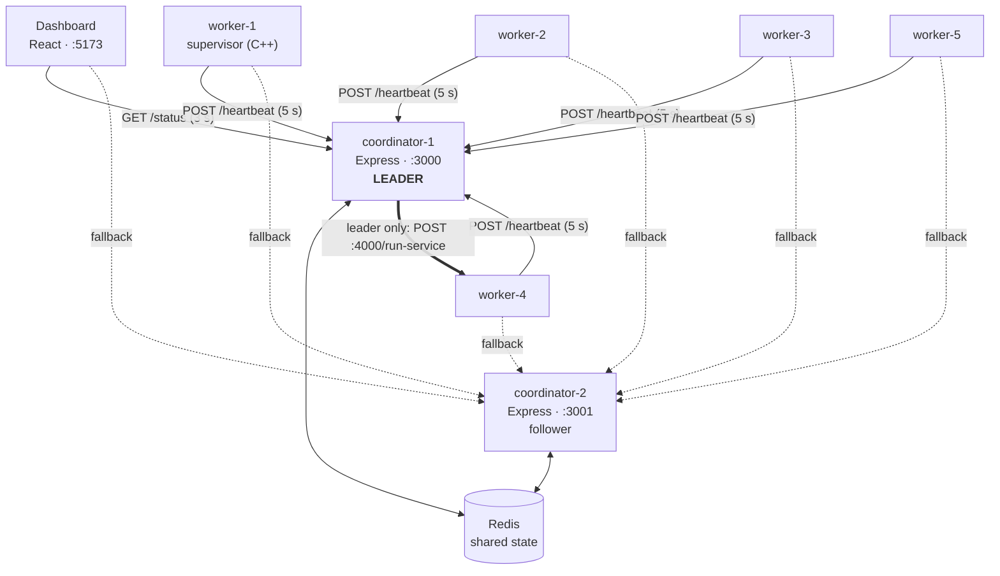
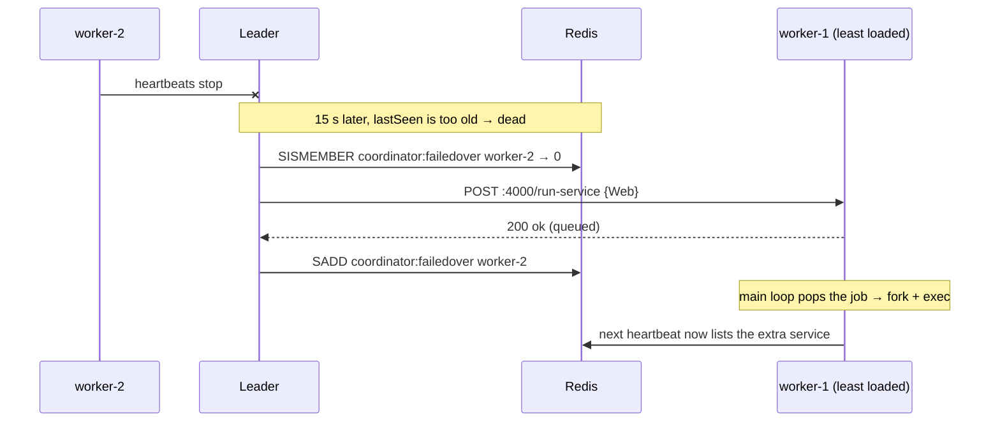

# Distributed Process Supervisor

A small, self-healing cluster that runs on one laptop. C++ worker agents start and babysit processes, report to two highly-available Node.js coordinators through Redis, and move services to healthy machines automatically when a machine dies. A React dashboard shows everything live.

> **C++17** · fork/exec · SIGCHLD · libcurl · POSIX sockets · std::thread  
> **Node.js 18** · Express 5 · ioredis · **Redis 7** · **React 18** · Vite · **Docker Compose**

---

## Contents

- [What it does](#what-it-does)
- [Architecture](#architecture)
- [Quick start](#quick-start)
- [Try the failure scenarios](#try-the-failure-scenarios)
- [How it works](#how-it-works)
- [Configuration](#configuration)
- [Project structure](#project-structure)
- [Testing](#testing)
- [Known limitations](#known-limitations)

---

## What it does

The project supervises processes at **two levels**:

| Level | Protects against | How |
|---|---|---|
| **Inside a machine** | a *process* crashing | Each worker forks its services from `services.yaml`, detects their death with `SIGCHLD`, and restarts them up to `max_restarts` times. |
| **Across machines** | a whole *machine* dying | Workers send a heartbeat every 5 s. If one goes silent for 15 s, the **leader** coordinator sends that worker's services to the least-loaded healthy workers. |

### Features

- **Local supervision.** Processes are created with `fork()` + `execvp()`, each in its own process group, with optional memory and CPU limits (`setrlimit`). They are reaped with `waitpid(-1, WNOHANG)` from a SIGCHLD handler, so no zombies are left behind, and restarted under a bounded policy.
- **Heartbeat-based failure detection.** Workers push their state; a worker is declared dead only after it misses about three heartbeats.
- **Automatic failover with least-loaded placement.** Each service of a dead worker goes to the alive worker running the fewest services.
- **Coordinator high availability.** There are two coordinator replicas. Leadership is a 30-second **lease** in Redis (`SET NX EX`), renewed every 10 s. If the leader dies, the other takes over.
- **Client-side failover.** Workers try coordinator-1, then coordinator-2, with 2 s curl timeouts. The dashboard falls back from port 3000 to 3001 the same way.
- **Stateless coordinators.** All shared state lives in Redis, including the "already failed over" marker, so a new or restarted leader never repeats a failover.
- **Thread-safe worker.** A producer–consumer queue passes failover jobs from the network thread to the process-owning main thread, and a mutex guards the service list that the heartbeat thread reads.
- **Live dashboard.** Worker cards, the current leader, service counts and an event log (offline, recovered, failover, leader changed) are built by comparing successive polls.

---

## Architecture



All nine containers share one Docker bridge network, `cluster-network`, and reach each other by service name through Docker's DNS. Only ports **3000**, **3001** and **5173** are published to the host. Redis (6379) and the workers' job port (4000) stay internal.

| Component | Count | Role |
|---|---|---|
| `worker-N` | 5 | Runs `./supervisor`: spawns and restarts services, sends heartbeats, accepts failover jobs on port 4000 |
| `coordinator`, `coordinator-2` | 2 | Store heartbeats in Redis, serve `/status`, compete for leadership. The leader detects failures and runs failover. |
| `redis` | 1 | Single source of truth for all shared state |
| `dashboard` | 1 | Polls `/status` and visualises the cluster |

---

## Quick start

### Prerequisites

- **Docker Desktop**, with Docker Compose v2
- Nothing else. The worker is compiled inside a Linux container, and Node runs in containers too.

### 1. Clone

```bash
git clone https://github.com/Saksham182004/distributed-process-supervisor.git
cd distributed-process-supervisor
```

### 2. Build the worker binary

The worker image only contains the runtime libraries. The `supervisor` binary is compiled separately and reaches the workers through a bind mount. It must be a **Linux** binary for your CPU architecture. The committed binary targets **arm64** (Apple Silicon). On any other machine, or after changing C++ code, rebuild it with:

```bash
docker run --rm -v "$PWD/worker-agent/src:/src" -w /src ubuntu:22.04 sh -c "\
  apt-get update -qq && apt-get install -y -qq g++ libyaml-cpp-dev libcurl4-openssl-dev && \
  g++ -o supervisor main.cpp process_manager.cpp signal_handler.cpp process_config.cpp \
      heartbeat_client.cpp run_service_server.cpp shared_queue.cpp \
      -std=c++17 -lyaml-cpp -lcurl -lpthread"
```

This uses the same `ubuntu:22.04` base as the worker image, so the library versions match.

### 3. Start the cluster

```bash
docker compose up -d
```

### 4. Open the dashboard

**http://localhost:5173**

Within about 15 seconds you should see 5/5 workers green, 10 services running, and a leader badge.

To stop everything, run `docker compose down`. Redis has no volume, so this also wipes the cluster state, which makes for a clean next start.

---

## Try the failure scenarios

Keep the dashboard open, and in a second terminal watch the coordinators' decisions:

```bash
docker compose logs -f coordinator coordinator-2 | grep -E "ELECTION|ALERT|FAILOVER"
```

**Kill a machine and watch its services move**

```bash
docker compose stop worker-2      # after ~15 s it turns red; within ~25 s its services move
docker compose start worker-2     # it recovers and turns green again
```

**Kill the leader and watch the other coordinator take over**

```bash
# find out which coordinator is leader
docker ps --format '{{.ID}} {{.Names}}' | grep "$(docker exec redis redis-cli get coordinator:leader)"

docker compose stop coordinator   # if coordinator-1 is leader; takeover within ~40 s
docker compose start coordinator  # rejoins as a follower
```

Workers stay green throughout, because their heartbeats fall back to coordinator-2.

**Watch the local restart policy**

```bash
docker compose exec worker-1 pkill -f "sleep 8"
docker compose logs -f --since 10s worker-1   # live: "Cache died! Restarting..." … "Giving up." — Ctrl+C to stop
```

**Inspect the shared state directly**

```bash
docker exec redis redis-cli keys '*'
docker exec redis redis-cli get coordinator:leader
docker exec redis redis-cli smembers coordinator:failedover
```

---

## How it works

### Worker agent (C++)

Each worker runs one process, `./supervisor`, with three threads:

| Thread | Job |
|---|---|
| **main** | Spawns the YAML services, then every 2 s drains the failover queue and handles one dead PID. It is the only thread that creates or restarts processes. |
| **heartbeat** | Every 5 s, copies the service list (under `servicesMutex`) and POSTs it to the first coordinator that answers. |
| **server (:4000)** | Accepts `POST /run-service` from the leader, parses the job, and pushes it onto `spawnQueue` (under `queueMutex`). |

A **SIGCHLD handler** reaps dead children and records their PIDs. The main loop then applies the restart rule:

```text
restart  if  max_restarts == -1  ||  restart_count < max_restarts
else     "exceeded max restarts. Giving up."
```

With `max_restarts: 3`, a service runs **four times**: the original start plus three restarts.

### Heartbeat

```http
POST /heartbeat
Content-Type: application/json

{"worker_id":"worker-1",
 "services":[{"name":"Web","command":"sleep 5","max_restarts":3},
             {"name":"Cache","command":"sleep 8","max_restarts":3}]}
```

The heartbeat carries the full service list, so the coordinator already has everything it needs to fail those services over later.

### Redis data model

| Key | Type | Value | Written by |
|---|---|---|---|
| `worker:<id>:lastSeen` | string | ms timestamp of the last heartbeat | `/heartbeat` (any coordinator) |
| `worker:<id>:services` | string (JSON) | the services the worker reported | `/heartbeat` (any coordinator) |
| `coordinator:leader` | string + 30 s TTL | hostname of the current leader | `tryBecomingLeader()` |
| `coordinator:failedover` | set | dead workers already failed over | leader's health monitor |

Worker keys are never deleted. A dead worker's `lastSeen` just keeps getting older, which is exactly how death is detected.

### Leader election

Every 10 s, on both coordinators:

```text
SET coordinator:leader <my-hostname> NX EX 30   → "OK"? I am the leader
else if GET coordinator:leader == me            → EXPIRE 30 (renew), still leader
else                                            → follower
```

`SET NX` is atomic, so only one coordinator can hold the key. If the leader dies, it stops renewing the lease, the key expires, and the other coordinator's next attempt succeeds.

### Failure detection and failover



For each service of the dead worker, `pickLeastLoaded()` chooses the alive worker with the fewest services. It then adds one to that worker's count straight away, so the next service sees the updated load. This spreads services across workers instead of stacking them on one. Once the worker heartbeats again, the leader removes it from the set with `SREM`.

---

## Configuration

### Services, per worker: `worker-agent/src/services.yaml`

```yaml
processes:
  - name: Web
    command: "sleep 5"
    max_memory_bytes: -1      # RLIMIT_AS in bytes; -1 = no limit
    max_cpu_seconds: -1       # RLIMIT_CPU in seconds; -1 = no limit
    max_restarts: 3           # -1 = restart forever
```

The `src/` folder is mounted into all five workers, so they share this file.

### Environment variables (`docker-compose.yml`)

| Variable | Used by | Example |
|---|---|---|
| `WORKER_ID` | worker | `worker-1` |
| `COORDINATOR_URL` | worker | `http://coordinator:3000/heartbeat,http://coordinator-2:3000/heartbeat`. A comma-separated list, tried in order. |
| `REDIS_URL` | coordinator | `redis://redis:6379` |
| `VITE_COORDINATOR_URLS` | dashboard (optional) | `http://localhost:3000,http://localhost:3001` |

### Timing

| Constant | Value | Where |
|---|---|---|
| Heartbeat interval | 5 s | `main.cpp` |
| Dead threshold | 15 s | `health-monitor.js`, `index.js` |
| Health-monitor tick | 10 s | `health-monitor.js` |
| Leader lease (TTL) | 30 s | `health-monitor.js` |
| Worker main loop | 2 s | `main.cpp` |
| Heartbeat curl timeout | 2 s | `heartbeat_client.cpp` |
| Dashboard poll | 3 s | `useClusterStatus.js` |

Worst case: about 25 s from a worker dying to its services being reassigned, and about 40 s from the leader dying to a new leader.

### After changing code

| Changed | Run |
|---|---|
| C++ (`worker-agent/src`) | Rebuild the binary (Quick start, step 2), then `docker compose up -d` |
| Coordinator JS | `docker compose restart coordinator coordinator-2` |
| Dashboard | nothing; Vite hot-reloads |
| `docker-compose.yml` | `docker compose up -d`. A plain `restart` does not re-read the file. |

---

## Project structure

```text
.
├── docker-compose.yml           # the whole cluster: 9 services on cluster-network
│
├── worker-agent/                # C++ — runs in each worker container
│   ├── Dockerfile               # ubuntu:22.04 + libyaml-cpp + libcurl (runtime only)
│   └── src/
│       ├── main.cpp             # entry point: threads, main loop, restart policy
│       ├── process_manager.*    # fork/exec, setrlimit, stop/kill, /proc stats
│       ├── signal_handler.*     # SIGCHLD handler, waitpid reaping
│       ├── process_config.*     # Process struct, services.yaml loader
│       ├── heartbeat_client.*   # heartbeat JSON + curl with fallback & timeouts
│       ├── run_service_server.* # raw-socket HTTP server on :4000
│       ├── shared_queue.*       # spawnQueue + queueMutex (producer → consumer)
│       ├── services.yaml        # services this worker runs
│       └── supervisor           # compiled Linux arm64 binary
│
├── coordinator/                 # Node.js — runs in both coordinator containers
│   └── src/
│       ├── index.js             # Express: /heartbeat, /status, CORS, Redis client
│       └── health-monitor.js    # leader election, failure detection, failover
│
└── dashboard/                   # React + Vite
    └── src/
        ├── useClusterStatus.js  # polling, endpoint fallback, event detection
        ├── App.jsx              # header, stat tiles, worker cards, event log
        └── index.css            # dark theme
```

---

## Testing

The system was checked with this 12-step test suite against the live cluster, and all twelve tests pass. Run them **in order**, because later tests build on the state earlier ones leave behind. Keep the dashboard open at http://localhost:5173 the whole time.

Commands with `logs -f` keep running and show new lines live. Press **Ctrl+C** to stop one and move on to the next command.

### Helpers

```bash
# Which coordinator is the leader right now?
docker ps --format '{{.ID}} {{.Names}}' | grep "$(docker exec redis redis-cli get coordinator:leader)"

# Live decisions from both coordinators (run this in a second terminal and leave it open)
docker compose logs -f coordinator coordinator-2 | grep -E "ELECTION|ALERT|FAILOVER|LEADER"
```

### Test 0 · Start from a clean state

```bash
docker compose down
docker compose up -d
# wait ~15 seconds
```

**Pass if:** `docker compose ps` shows all 9 containers `Up`, and the dashboard shows 5/5 workers green.

### Test 1 · Heartbeats

```bash
docker compose logs -f --tail 10 coordinator | grep Heartbeat
docker exec redis redis-cli get worker:worker-1:lastSeen      # run twice, ~5s apart
docker exec redis redis-cli get worker:worker-1:services
```

**Pass if:** all 5 workers appear in the logs every 5s; `lastSeen` increases between the two runs; `services` shows the Web/Cache JSON.

### Test 2 · Local process supervision (restart on crash)

```bash
docker compose exec worker-1 pkill -f "sleep 8"      # kill the Cache process by hand
docker compose logs -f --tail 10 worker-1
```

**Pass if:** `Cache died! Restarting...` then `Spawned process with PID: ...`. After 3 restarts: `exceeded max restarts. Giving up.`

### Test 3 · Leader election

```bash
docker exec redis redis-cli get coordinator:leader
docker exec redis redis-cli ttl coordinator:leader
docker compose logs -f --tail 4 coordinator coordinator-2 | grep ELECTION
```

**Pass if:** exactly one coordinator logs `LEADER`, the other `follower`; the TTL is between 1 and 30 and goes back to 30 every 10s.

### Test 4 · Worker failure and least-loaded failover

```bash
docker compose stop worker-2
# wait ~25 seconds
docker compose logs -f --tail 30 coordinator coordinator-2 | grep -E "ALERT|FAILOVER"
docker compose logs -f --tail 10 worker-1 worker-3 worker-4 worker-5 | grep RUN-SERVICE
docker exec redis redis-cli SMEMBERS coordinator:failedover
```

**Pass if:** `[ALERT] worker-2 DEAD`; Web and Cache each go to a **different** worker (`→ worker-X (load 2)`), each `accepted (200)`; targets log `[RUN-SERVICE] Started: ...`; `SMEMBERS` returns `worker-2`.

### Test 5 · Several failures spread by load

```bash
docker compose stop worker-3
# wait ~25 seconds
docker compose logs -f --tail 20 coordinator coordinator-2 | grep FAILOVER
```

**Pass if:** worker-3's services avoid the workers that already took worker-2's; they go to the ones still at load 2.

### Test 6 · No repeated failover after a leader change

```bash
# run while worker-2 and worker-3 are still dead
docker compose restart coordinator coordinator-2
# wait ~20 seconds
docker compose logs -f --tail 30 coordinator coordinator-2 | grep -E "ALERT|FAILOVER"
```

**Pass if:** `[ALERT] worker-2 DEAD` and `[ALERT] worker-3 DEAD`, but **no** new `[FAILOVER]` lines.

### Test 7 · Worker recovery

```bash
docker compose start worker-2 worker-3
# wait ~15 seconds
docker exec redis redis-cli SMEMBERS coordinator:failedover
```

**Pass if:** both workers turn green and the dashboard log shows `recovered`; `SMEMBERS` comes back empty.

### Test 8 · Coordinator leader failover

```bash
docker ps --format '{{.ID}} {{.Names}}' | grep "$(docker exec redis redis-cli get coordinator:leader)"
# stop THAT container, e.g.:
docker compose stop coordinator
# wait up to ~30 seconds
docker exec redis redis-cli get coordinator:leader
docker compose logs -f --tail 10 coordinator-2 | grep ELECTION
```

**Pass if:** the leader key holds the other coordinator's ID and its log says `LEADER`; the dashboard shows **Leader changed**.

### Test 9 · Heartbeat fallback

```bash
# still with coordinator-1 stopped
docker compose logs -f --tail 6 worker-1
docker compose logs -f --tail 10 coordinator-2 | grep Heartbeat
```

**Pass if:** the worker logs `coordinator:3000 ... failed` but **not** `no coordinator reachable`; coordinator-2 receives heartbeats from all 5 workers; all stay green and the status bar shows `localhost:3001`.

### Test 10 · No alive workers (edge case)

```bash
docker compose stop worker-1 worker-2 worker-3 worker-4 worker-5
# wait ~25 seconds
docker compose logs -f --tail 15 coordinator-2 | grep FAILOVER
```

**Pass if:** `[FAILOVER] No alive workers available!` with no crash; the dashboard shows 0 alive and 5 dead.

### Test 11 · Dashboard loses all coordinators

```bash
docker compose stop coordinator-2      # coordinator-1 is already stopped
```

**Pass if:** a red "Can't reach the coordinator" banner; the status bar shows `Disconnected`; the event log shows **Coordinator unreachable**; the cards keep their last state.

### Test 12 · Bring everything back

```bash
docker compose up -d
```

**Pass if:** within ~15 seconds the dashboard shows **Connection restored** and 5/5 green, and one coordinator is `LEADER`.

### What each test demonstrates

| # | Demonstrates |
|---|---|
| 1 | Heartbeat-based liveness |
| 2 | Local supervision and a bounded restart policy |
| 3 | Lease-based leader election |
| 4 – 5 | Failure detection and load-aware failover |
| 6 | Stateless coordinators: shared state lives in Redis |
| 7 | Worker recovery |
| 8 | Coordinator high availability |
| 9 | Client-side failover |
| 10 – 11 | Graceful degradation |

---

## Known limitations

These are deliberate trade-offs for a single-laptop cluster:

- **Redis is a single point of failure.** A production system would use Redis Sentinel or Cluster, or etcd/ZooKeeper.
- **Services are assumed to be stateless.** Failover starts a command fresh, so local data is not migrated.
- **Duplicates after recovery.** A recovered worker restarts its own services while the failed-over copies keep running elsewhere. That is harmless for stateless services.
- **"Load" means the number of services**, not CPU or memory use.
- **Failover is fire-and-forget.** The leader does not wait for the worker to confirm a job, so a failed request is not retried.
- **Leader gap.** After the leader dies, failover pauses until its 30 s lease expires (up to about 40 s).
- **Minimal HTTP/JSON handling in C++.** The heartbeat JSON is built by hand without escaping, and the job server does a single `recv()`.

---

## Author

**Saksham**, 3rd-year project, October 2026.
